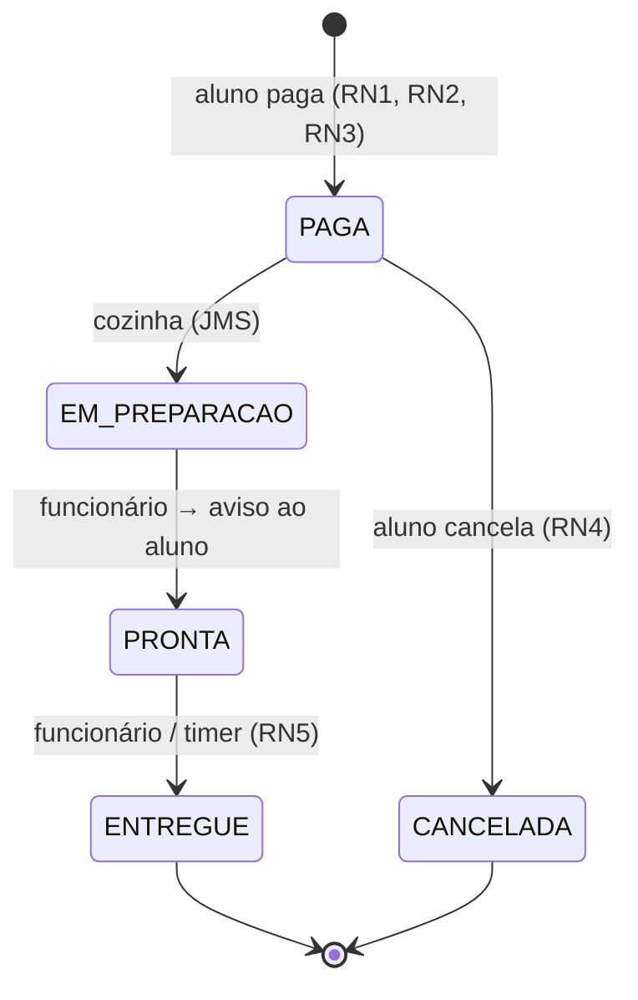

<p align="center"></p>


**Encomendas antecipadas no bar da escola, pagas com o saldo do cartão de estudante.**

Projeto Integrador · UFCD 10791 · Aplicação web empresarial em Jakarta EE 10

---

## Índice

1. [O problema](#1-o-problema)
2. [Objetivo](#2-objetivo)
3. [Utilizadores e papéis](#3-utilizadores-e-papéis)
4. [Funcionalidades (user stories)](#4-funcionalidades-user-stories)
5. [Regras de negócio](#5-regras-de-negócio)
6. [Modelo de dados](#6-modelo-de-dados)
7. [Ciclo de vida da encomenda](#7-ciclo-de-vida-da-encomenda)
8. [Arquitetura](#8-arquitetura)
9. [Tecnologias utilizadas](#9-tecnologias-utilizadas)
10. [Páginas da aplicação](#10-páginas-da-aplicação)
11. [API](#11-api)
12. [Como executar](#12-como-executar)
13. [Desenvolvimento por etapas](#13-desenvolvimento-por-etapas)
14. [Segurança](#14-segurança)
15. [Testes](#15-testes)
16. [Documentação](#16-documentação)
17. [Equipa](#17-equipa)
18. [Uso de IA](#18-uso-de-ia)
19. [Referências](#19-referências)

---

## 1. O problema

Os intervalos da escola têm apenas **15 minutos**. Nesse tempo forma-se uma fila enorme no bar e
**muitos alunos voltam para a aula sem lanchar**.

O bar já usa o **cartão de estudante com saldo**, mas todo o processo é feito ao balcão: escolher,
pagar e esperar acontece no mesmo momento, para todos ao mesmo tempo.

A **associação de pais** propôs uma solução: **encomendas antecipadas**. O aluno encomenda durante a
aula anterior e só tem de levantar o pedido no intervalo.

## 2. Objetivo

Construir uma aplicação web onde:

- os **alunos** veem o menu, encomendam e **pagam com o saldo do cartão**;
- o **bar** recebe os pedidos **por ordem**, prepara-os e **avisa quando estão prontos**;
- a **gestão** controla produtos, preços, stock, carregamentos de saldo e vendas.

**Resultado esperado:** menos fila no intervalo, menos alunos sem lanche e um bar mais organizado.

## 3. Utilizadores e papéis

| Papel | O que faz |
|---|---|
| **ALUNO** | Consulta o menu, encomenda, paga e acompanha o pedido |
| **FUNCIONARIO** | Vê a fila de encomendas e marca-as como prontas/entregues |
| **GESTOR** | Gere produtos, preços, stock e carregamentos de saldo; consulta as vendas |

## 4. Funcionalidades (user stories)

| ID | User story | Estado | Onde está implementada |
|---|---|:---:|---|
| US01 | Como **aluno**, quero ver o menu do dia com preços e disponibilidade | ✅ | `aluno/menu.html`, `GET /api/produtos` |
| US02 | Como **aluno**, quero juntar produtos a um carrinho e encomendar para um intervalo | ✅ | `js/menu.js`, `POST /api/encomendas` (e versão JSP em `/menu`) |
| US03 | Como **aluno**, quero pagar com o saldo do cartão e ver o saldo restante | ✅ | `EncomendaService.pagar()`, `PagamentoDTO.saldoRestante` |
| US04 | Como **aluno**, quero ser avisado quando o meu pedido estiver pronto | ✅ | WebSocket `/ws/aluno`, `aluno/pedidos.html` |
| US05 | Como **funcionário**, quero ver as encomendas por intervalo e por ordem de chegada | ✅ | `balcao/fila.html`, `GET /api/encomendas` |
| US06 | Como **gestor**, quero gerir produtos, preços e stock | ✅ | `backoffice/produtos.xhtml`, CRUD `/api/produtos` |
| US07 | Como **gestor**, quero ver as vendas do dia | ✅ | `backoffice/vendas.xhtml`, `GET /api/vendas?data=` |

## 5. Regras de negócio

| Regra | Descrição | Implementação |
|---|---|---|
| **RN1** | Só se encomenda se o saldo cobrir o total | `EncomendaService.pagar()` → `Aluno.temSaldoPara()` → `SaldoInsuficienteException` |
| **RN2** | Só se encomenda se houver stock de todos os produtos; o stock desce ao pagar | `EncomendaService.pagar()` → `Produto.baixarStock()` → `StockInsuficienteException` |
| **RN3** | As encomendas para um intervalo fecham 15 minutos antes do seu início | `Intervalo.aceitaEncomendas()` → `EncomendasFechadasException` |
| **RN4** | Uma encomenda só pode ser cancelada enquanto estiver PAGA; o saldo e o stock são repostos | `EncomendaService.cancelar()`, `EstadoEncomenda.podeCancelar()` |
| **RN5** | No fim do dia, encomendas PRONTA não levantadas passam a ENTREGUE, com registo | `FechoDiaTimer` (`@Schedule` às 23:30) → `EncomendaService.fecharDia()` |

### Transação do pagamento (RN1 + RN2)

O pagamento é uma operação **"tudo ou nada"**: descontar o saldo, baixar o stock e gravar a
encomenda acontecem numa **única transação JTA**.

O método `pagar()` desconta primeiro o saldo e só depois baixa o stock, produto a produto. Se o stock
falhar a meio, é lançada uma `NegocioException` anotada com `@ApplicationException(rollback = true)`.
O contentor desfaz tudo e **o saldo não fica descontado**.

Para dois alunos não comprarem ao mesmo tempo o último produto, o pagamento usa *locks* pessimistas
(`PESSIMISTIC_WRITE`) e as entidades têm controlo de versão (`@Version`).

## 6. Modelo de dados

| Entidade | Atributos principais | Relações |
|---|---|---|
| **Produto** | nome, preço, stock, ativo | N—1 Categoria |
| **Categoria** | nome (bebidas, sandes, fruta…) | 1—N Produto |
| **Aluno** | número, nome, turma, saldo | 1—N Encomenda |
| **Encomenda** | data/hora, intervalo, total, estado | N—1 Aluno · N—1 Intervalo · 1—N LinhaEncomenda |
| **LinhaEncomenda** | quantidade, preço unitário | N—1 Encomenda · N—1 Produto |
| **Intervalo** | hora de início, hora de fecho das encomendas | 1—N Encomenda |

O preço unitário de cada linha é guardado **no momento da compra**. Se o preço do produto mudar
depois, as encomendas antigas não são alteradas.

Diagrama completo: [docs/diagramas/entidade-relacao.md](barescola/docs/diagramas/entidade-relacao.md)

## 7. Ciclo de vida da encomenda



**PAGA → EM_PREPARACAO → PRONTA → ENTREGUE** (ou **CANCELADA**)

## 8. Arquitetura

A aplicação segue uma **arquitetura em camadas**:

```
┌──────────────────────────────────────────────────────────────────┐
│ APRESENTAÇÃO   HTML/CSS/JS (fetch) · Servlets + JSP · JSF        │
├──────────────────────────────────────────────────────────────────┤
│ API            JAX-RS (REST/JSON) · WebSockets · JAX-WS (SOAP)   │
├──────────────────────────────────────────────────────────────────┤
│ NEGÓCIO        EJB (transações, segurança) · JMS + MDB · Timer   │
├──────────────────────────────────────────────────────────────────┤
│ PERSISTÊNCIA   JPA (Hibernate)                                    │
├──────────────────────────────────────────────────────────────────┤
│ BASE DE DADOS  H2                                                 │
└──────────────────────────────────────────────────────────────────┘
```

### Estrutura do projeto

```
Bar_Escola/                       repositório Git
├── README.md                     este documento
└── barescola/                    projeto Maven
    ├── pom.xml                       configuração Maven
    ├── api.http                      pedidos de teste (VS Code REST Client)
    ├── scripts/                      configuração do WildFly (datasource + utilizadores)
    ├── docs/                         diagramas, Postman, SOAP, manual, checklist
    └── src/
        ├── main/java/pt/escola/barescola/
        │   ├── config/               JAX-RS, papéis, relógio, dados iniciais
        │   ├── model/                entidades JPA + EstadoEncomenda
        │   ├── dto/                  objetos de entrada/saída da API
        │   ├── service/              EJB com as regras de negócio + exceções
        │   ├── jms/                  fila da cozinha (produtor + MDB)
        │   ├── timer/                fecho do dia (@Schedule)
        │   ├── rest/                 recursos JAX-RS + tratamento de erros
        │   ├── websocket/            avisos em tempo real
        │   ├── soap/                 serviço CartaoWS
        │   ├── web/                  servlets, carrinho de sessão, filtros
        │   └── jsf/                  backing beans do backoffice
        ├── main/webapp/
        │   ├── aluno/                menu e pedidos do aluno
        │   ├── balcao/               ecrã do balcão
        │   ├── backoffice/           páginas JSF de gestão
        │   ├── prototipo/            protótipo da etapa 2 (dados falsos)
        │   ├── WEB-INF/              web.xml, JSP, templates JSF
        │   └── css/ · js/            estilos e scripts
        └── test/java/                testes unitários (JUnit 5)
```

Diagrama de camadas detalhado: [docs/diagramas/arquitetura.md](barescola/docs/diagramas/arquitetura.md)

## 9. Tecnologias utilizadas

### Back-end (Jakarta EE 10)

| Tecnologia | Para que foi usada |
|---|---|
| **Java 21** | Linguagem de programação (inclui *records* e *switch expressions*) |
| **Jakarta Servlet + JSP + JSTL** | Menu gerado no servidor e carrinho guardado na sessão (etapa 3) |
| **Jakarta Persistence (JPA)** com Hibernate | Mapeamento das 6 entidades e consultas JPQL, incluindo as vendas do dia com `SUM` |
| **Jakarta Bean Validation** | Validação dos dados nas entidades e nos pedidos à API |
| **Jakarta Enterprise Beans (EJB)** | Serviços de negócio com transações, segurança por papel e timer (`@Schedule`) |
| **Jakarta CDI** | Injeção de dependências e eventos disparados depois do *commit* |
| **Jakarta RESTful Web Services (JAX-RS)** + JSON-B | API REST em JSON consumida pelo front-end |
| **Jakarta Faces (JSF)** | Backoffice de produtos, stock, vendas e saldos |
| **Jakarta WebSocket** | Aviso em tempo real "o teu pedido está pronto" e atualização do balcão |
| **Jakarta Messaging (JMS)** | Fila da cozinha, consumida por um *Message-Driven Bean* |
| **Jakarta XML Web Services (JAX-WS)** | Serviço SOAP `CartaoWS` para o sistema de cartões da escola |
| **Jakarta Security** (FORM login) | Autenticação e autorização com os papéis ALUNO, FUNCIONARIO e GESTOR |

### Front-end

| Tecnologia | Para que foi usada |
|---|---|
| **HTML5 + CSS3** | Interface responsiva, pensada primeiro para telemóvel |
| **JavaScript (módulos ES)** | Carrinho, chamadas à API com `fetch` e ligação WebSocket |

### Servidor, dados e ferramentas

| Ferramenta | Para que foi usada |
|---|---|
| **WildFly** (perfil `standalone-full`) | Servidor de aplicações Jakarta EE (inclui o broker JMS) |
| **H2 Database** | Base de dados relacional guardada em ficheiro |
| **Apache Maven** | Gestão de dependências e *build* do `barescola.war` |
| **JUnit 5** | Testes unitários das regras de domínio |
| **Visual Studio Code** | Ambiente de desenvolvimento, com tarefas de *build*/deploy e depuração |
| **Git + GitHub** | Controlo de versões, tags por etapa e quadro Kanban |
| **Postman** | Testes da API REST |
| **SoapUI** | Testes do serviço SOAP |
| **Mermaid** | Diagramas (ER, estados e camadas) dentro da documentação |

## 10. Páginas da aplicação

| Página | Endereço | Papel |
|---|---|---|
| Login | `/login.html` | todos |
| Criar conta de aluno | `/registo.html` | público |
| Menu do dia, carrinho e pagamento | `/aluno/menu.html` | ALUNO |
| Os meus pedidos (com estado) | `/aluno/pedidos.html` | ALUNO |
| Ecrã do balcão (fila de encomendas) | `/balcao/fila.html` | FUNCIONARIO, GESTOR |
| Backoffice: produtos e stock | `/backoffice/produtos.xhtml` | GESTOR |
| Backoffice: vendas do dia | `/backoffice/vendas.xhtml` | GESTOR |
| Backoffice: carregamentos de saldo | `/backoffice/saldos.xhtml` | GESTOR |
| Menu em Servlet + JSP (etapa 3) | `/menu` | ALUNO |
| Protótipo com dados falsos (etapa 2) | `/prototipo/menu-estatico.html` | público |

## 11. API

### REST (JSON)

| Método | Endpoint | Papel | Respostas |
|---|---|---|---|
| GET | `/api/estado` | público | 200 |
| POST | `/api/registo` | público (cria conta de aluno) | 201, 400, 409 |
| GET | `/api/me` | todos | 200 |
| GET | `/api/produtos?ativos=true` | todos | 200 |
| GET | `/api/produtos/{id}` · `/api/produtos/categorias` | todos | 200, 404 |
| POST | `/api/produtos` | GESTOR | 201 + `Location`, 400, 403 |
| PUT | `/api/produtos/{id}` | GESTOR | 200, 400, 404 |
| PATCH | `/api/produtos/{id}/stock` | GESTOR | 200, 400, 404 |
| DELETE | `/api/produtos/{id}` | GESTOR | 204 (apagado), 200 (desativado), 404 |
| GET | `/api/intervalos` | todos | 200 |
| POST | `/api/encomendas` | ALUNO | 201 + `Location`, 400, 404, 409 |
| GET | `/api/encomendas/minhas` | ALUNO | 200 |
| POST | `/api/encomendas/{id}/cancelar` | ALUNO (dono) | 200, 403, 404, 409 |
| GET | `/api/encomendas/{id}` | dono ou bar | 200, 403, 404 |
| GET | `/api/encomendas?data=&intervaloId=` | FUNCIONARIO, GESTOR | 200 |
| PUT | `/api/encomendas/{id}/estado` | FUNCIONARIO, GESTOR | 200, 404, 409 |
| GET | `/api/alunos` | GESTOR | 200 |
| POST | `/api/alunos/{numero}/carregamentos` | GESTOR | 200, 400, 404 |
| GET | `/api/vendas?data=aaaa-mm-dd` | GESTOR | 200, 400 |

Todos os erros seguem o mesmo formato:

```json
{ "status": 409, "codigo": "SALDO_INSUFICIENTE", "mensagem": "Saldo insuficiente: ...", "detalhes": [] }
```

### WebSockets

| Endpoint | Papel | Mensagens |
|---|---|---|
| `/ws/aluno` | ALUNO | `PEDIDO_PRONTO`, `ESTADO_ALTERADO` (só das encomendas do próprio aluno) |
| `/ws/balcao` | FUNCIONARIO, GESTOR | Atualizações da fila (novas encomendas, mudanças de estado) |

### SOAP

| Serviço | Operação | WSDL |
|---|---|---|
| `CartaoWS` | `saldo(numeroCartao)` → número, nome, turma, saldo · *fault* `CartaoInvalido` | `http://localhost:8080/barescola/CartaoWS?wsdl` |

## 12. Como executar

### Requisitos

- **JDK 21**
- **Apache Maven 3.9+**
- **WildFly** com suporte a Jakarta EE 10 → <https://www.wildfly.org/downloads/>

### Instalação automática (macOS)

Um único script instala e configura todo o ambiente, sem precisar de palavra-passe de administrador:
JDK 21 (Temurin), Maven, WildFly EE 10, variáveis de ambiente, base de dados, utilizadores de teste,
compilação, arranque do servidor e deploy.

```bash
cd barescola
bash scripts/instalar-mac.sh
```

No fim, a aplicação abre sozinha em <http://localhost:8080/barescola>.

| Componente | Local de instalação |
|---|---|
| JDK 21 | `~/Library/Java/JavaVirtualMachines/temurin-21.jdk` |
| Maven | `~/Developer/maven` |
| WildFly EE 10 | `~/Developer/wildfly` |
| Log do servidor | `~/Developer/logs/wildfly.log` |

### Instalação manual

0. **Entrar na pasta do projeto** (todos os comandos seguintes correm dentro dela)
   ```bash
   cd barescola
   ```
1. **Definir a localização do WildFly**
   ```bash
   export WILDFLY_HOME=~/wildfly                      # macOS / Linux
   $env:WILDFLY_HOME = "C:\wildfly"                   # Windows (PowerShell)
   ```
2. **Configurar a base de dados e os utilizadores de teste** (com o servidor parado; só uma vez)
   ```bash
   ./scripts/setup-wildfly.sh                                          # macOS / Linux
   powershell -ExecutionPolicy Bypass -File scripts\setup-wildfly.ps1  # Windows
   ```
3. **Arrancar o WildFly com o perfil *full*** (necessário para o JMS)
   ```bash
   $WILDFLY_HOME/bin/standalone.sh -c standalone-full.xml
   ```
4. **Compilar e fazer o deploy**
   ```bash
   mvn clean package wildfly:deploy
   ```
5. **Abrir** <http://localhost:8080/barescola>

As tabelas e os dados de exemplo (produtos, alunos e intervalos) são criados automaticamente no primeiro arranque.

### Utilizadores de teste

| Papel | Email | Palavra-passe | Saldo inicial |
|---|---|---|---|
| ALUNO | `aluno1@barescola.pt` | `Aluno#2026` | 15,00 € |
| ALUNO | `aluno2@barescola.pt` | `Aluno#2026` | 2,00 € |
| ALUNO | `aluno3@barescola.pt` | `Aluno#2026` | 8,50 € |
| FUNCIONARIO | `balcao@barescola.pt` | `Balcao#2026` | — |
| GESTOR | `gestor@barescola.pt` | `Gestor#2026` | — |

### No Visual Studio Code

| Ação | Como |
|---|---|
| Compilar | **Ctrl+Shift+B** (`Maven: package`) |
| Configurar / iniciar / deploy no WildFly | **Terminal → Run Task…** |
| Depurar o código no servidor | **F5** → `Depurar WildFly (attach 8787)` |
| Testar a API | Abrir `api.http` → **Send Request** |

### Modo demonstração

Os intervalos de exemplo são às 10:05, 11:50, 13:20, 15:05 e 16:50. Depois das 16:35, a RN3 bloqueia
novas encomendas. Para demonstrar a aplicação a qualquer hora, arrancar o WildFly com a variável
`BARESCOLA_MODO_DEMO=true`. Ver [docs/demo-day.md](barescola/docs/demo-day.md).

## 13. Desenvolvimento por etapas

O projeto foi desenvolvido de forma **progressiva**: cada etapa acrescenta uma camada tecnológica e
fica marcada com uma *tag* Git.

| Etapa | Tecnologia | O que foi implementado | Critério de conclusão | Tag | Estado |
|---|---|---|---|---|:---:|
| 1 | Jakarta EE | Projeto `barescola`, pacotes, endpoint `/api/estado`, diagrama de camadas | O endpoint responde no browser | `etapa-1` | ✅ |
| 2 | HTML/CSS/JS | Menu com cartões de produtos (dados falsos), carrinho com total automático | Juntar/remover produtos atualiza o total | `etapa-2` | ✅ |
| 3 | Servlets/JSP | `MenuServlet` + JSP, carrinho na sessão, formulário de encomenda | Encomenda criada a partir do carrinho da sessão | `etapa-3` | ✅ |
| 4 | JPA | 6 entidades, consulta das vendas do dia (`SUM` por produto) | Dados na BD; vendas com parâmetro de data | `etapa-4` | ✅ |
| 5 | EJB | `EncomendaService.pagar()` com RN1–RN4 numa só transação; `@Schedule` para RN5 | Sem saldo ou sem stock, nada fica alterado | `etapa-5` | ✅ |
| 6 | JAX-RS | CRUD `/api/produtos`, operações `/api/encomendas`; menu com `fetch` | Menu com dados reais; coleção Postman completa | `etapa-6` | ✅ |
| 7 | JSF/WebSockets | Backoffice JSF; aviso "o teu pedido está pronto" | Aluno vê o aviso sem recarregar | `etapa-7` | ✅ |
| 8 | JMS | Encomenda paga → fila da cozinha → MDB põe-na EM_PREPARACAO e regista no log | Pagamento responde logo; estado muda segundos depois | `etapa-8` | ✅ |
| 9 | SOAP | `CartaoWS.saldo(numeroCartao)` | Teste válido e inválido no SoapUI | `etapa-9` | ✅ |
| 10 | Segurança | Papéis ALUNO/FUNCIONARIO/GESTOR; um aluno só vê e cancela as suas encomendas | Checklist de segurança completa | `etapa-10` | ✅ |

Os ficheiros que pertencem a cada etapa estão em [docs/plano-etapas.md](barescola/docs/plano-etapas.md).

## 14. Segurança

- **Autenticação** por formulário (FORM login) e utilizadores com *password* em *hash* no WildFly.
- **Autorização em duas camadas:** restrições por URL no `web.xml` e `@RolesAllowed` nos recursos REST e nos EJB.
- **Isolamento de dados:** o aluno é identificado pela sessão do servidor, nunca por um id enviado pelo cliente, por isso só vê e cancela as suas encomendas.
- **Preços calculados no servidor:** o cliente envia apenas produto e quantidade.
- **Proteção contra XSS e SQL injection:** texto escapado no front-end e apenas JPQL com parâmetros.
- **Erros controlados:** a API nunca devolve *stack traces*.
- **Cabeçalhos HTTP de segurança** e cookie de sessão `HttpOnly`.

Checklist completa: [docs/checklist-seguranca.md](barescola/docs/checklist-seguranca.md)

## 15. Testes

| Tipo | Ferramenta | Localização |
|---|---|---|
| Unitários (regras de domínio, estados, carrinho) | JUnit 5 | `src/test/java` → `mvn test` |
| API REST | Postman | `docs/postman/barescola.postman_collection.json` |
| API REST (no editor) | VS Code REST Client | `api.http` |
| Serviço SOAP | SoapUI | `docs/soap/` |
| Segurança | Testes manuais | `docs/checklist-seguranca.md` |

## 16. Documentação

| Documento | Ficheiro |
|---|---|
| Diagrama entidade-relação | [docs/diagramas/entidade-relacao.md](barescola/docs/diagramas/entidade-relacao.md) |
| Diagrama de estados da encomenda | [docs/diagramas/estados-encomenda.md](barescola/docs/diagramas/estados-encomenda.md) |
| Diagrama de camadas | [docs/diagramas/arquitetura.md](barescola/docs/diagramas/arquitetura.md) |
| Coleção Postman | [docs/postman/](barescola/docs/postman/) |
| Projeto SoapUI e WSDL | [docs/soap/](barescola/docs/soap/) |
| Manual de utilizador | [docs/manual-utilizador.md](barescola/docs/manual-utilizador.md) |
| Checklist de segurança | [docs/checklist-seguranca.md](barescola/docs/checklist-seguranca.md) |
| Plano por etapas, Git e Kanban | [docs/plano-etapas.md](barescola/docs/plano-etapas.md) |
| Guião do Demo Day | [docs/demo-day.md](barescola/docs/demo-day.md) |

## 17. Equipa

| Nome | Papéis que desempenhou | Contribuições principais |
|------|------------------------|--------------------------|
|      |                        |                          |
|      |                        |                          |
|      |                        |                          |

## 18. Uso de IA

| | |
|---|---|
| **O que pedimos** | Apoio na estrutura inicial do projeto a partir do guia: código das 10 etapas, documentação e configuração do VS Code. |
| **O que aproveitámos** | _(preencher pela equipa)_ |
| **O que tivemos de corrigir** | _(preencher pela equipa – ex.: erros de compilação, configuração do WildFly, testes no SoapUI)_ |

## 19. Referências

| Recurso | Para quê |
|---|---|
| [Jakarta EE – Especificações](https://jakarta.ee/specifications/) | Documentação oficial de cada especificação (Servlet, JPA, EJB, JAX-RS…) |
| [Jakarta EE – Learn](https://jakarta.ee/learn/) | Tutoriais e material de aprendizagem oficial |
| [WildFly Quickstarts](https://github.com/wildfly/quickstart) | Exemplos oficiais de cada tecnologia a correr no WildFly |
| [Baeldung](https://www.baeldung.com/) | Artigos práticos sobre Java, JPA, REST e segurança |
| [MDN Web Docs](https://developer.mozilla.org/en-US/) | Referência de HTML, CSS, JavaScript e WebSockets |
| [OWASP Top Ten](https://owasp.org/projects/top-ten) | Os 10 riscos de segurança web mais críticos (base da checklist de segurança) |
| [OWASP WebGoat](https://owasp.org/projects/webgoat) | Aplicação de treino para praticar e perceber vulnerabilidades |

---

<sub>BarEscola · Projeto Integrador UFCD 10791 · Desenvolvido com Jakarta EE 10 e WildFly</sub>
