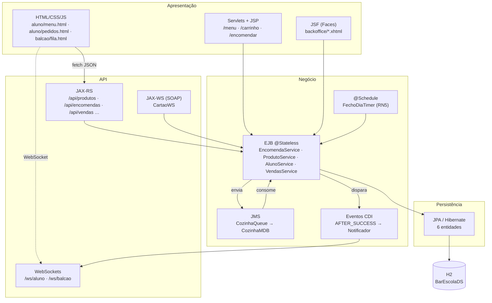

# Diagrama de camadas

## Pacotes

| Pacote | Camada | Conteúdo |
|---|---|---|
| `pt.escola.barescola.model` | Persistência | Entidades JPA + enum de estados |
| `pt.escola.barescola.dto` | API | Records de entrada/saída (nunca se expõem entidades) |
| `pt.escola.barescola.service` | Negócio | EJB com as regras RN1–RN5 e exceções de negócio |
| `pt.escola.barescola.jms` | Negócio | Produtor e MDB da fila da cozinha |
| `pt.escola.barescola.timer` | Negócio | Timer de fecho do dia |
| `pt.escola.barescola.rest` | API | Recursos JAX-RS e *exception mappers* |
| `pt.escola.barescola.websocket` | API | Endpoints e notificador WebSocket |
| `pt.escola.barescola.soap` | API | Serviço SOAP `CartaoWS` |
| `pt.escola.barescola.web` | Apresentação | Servlets, carrinho de sessão, filtro de segurança |
| `pt.escola.barescola.jsf` | Apresentação | *Backing beans* do backoffice |
| `pt.escola.barescola.config` | Transversal | JAX-RS, papéis, relógio, dados iniciais |
