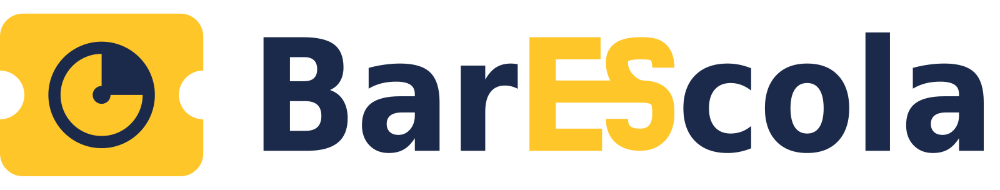

# Logótipo BarEscola

## Conceito

- **Senha de bar** (talão amarelo com recortes laterais): o aluno encomenda e recebe uma senha para levantar.
- **Relógio com um quarto preenchido**: os 15 minutos do intervalo – o problema que a aplicação resolve.
- **Monograma "ES" a amarelo**: o braço do meio do **E** continua e torna-se a curva do **S** – as duas letras de **Es**cola formam uma só peça, na cor do símbolo, ligando o nome à senha.

## Ficheiros

| Ficheiro | Uso |
|---|---|
| `logo.svg` / `barescola-logo.png` | Versão principal, para fundos claros (relatório, apresentação) |
| `logo-branco.svg` / `barescola-logo-fundo-escuro.png` | Para fundos escuros (cabeçalho da aplicação, slides escuros) |
| `logo-frase.svg` / `barescola-logo-frase.png` | Com a frase "Encomenda na aula. Levanta no intervalo." (capa do relatório) |
| `simbolo.svg` / `barescola-simbolo.png` | Só o símbolo (ícone do separador do browser, avatar, redes) |

Os SVG não dependem de nenhuma fonte instalada (o texto está convertido em formas), por isso ficam iguais em qualquer computador. Para trabalhos impressos ou Word/PowerPoint, usar os PNG.

## Cores

| Nome | Hex | Uso |
|---|---|---|
| Azul-marinho | `#1B2A4A` | Texto do logótipo, cabeçalho, botões |
| Amarelo senha | `#FFC629` | Símbolo, estado "pronto", destaques |
| Papel | `#ECEEF1` | Fundo da aplicação |

## Regras de utilização

- Manter uma margem livre à volta do logótipo de, pelo menos, metade da altura do símbolo.
- Não alterar as cores, não esticar e não aplicar sombras ou contornos.
- Tamanho mínimo: 24 px de altura no ecrã.
- Letra do nome: DejaVu Sans Condensed Bold (licença livre).
- Só o monograma **ES** usa o amarelo; o resto do nome é azul-marinho (ou branco em fundo escuro).
- Os ficheiros são gerados por `gerar-logo.py` (Python + fontTools): `python3 gerar-logo.py <pasta-destino>`.
